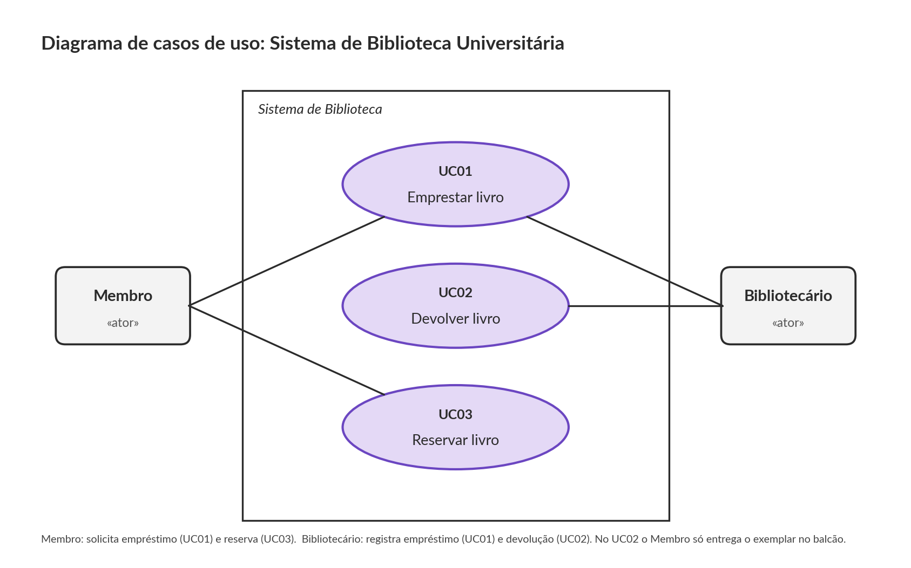

# TP1 — Requisitos e casos de uso

**Aluno:** Daniel Corazza  
**Disciplina:** Projeto de Bloco: Desenvolvimento Back-End [26E4_5]

## 1. Contexto do sistema

O domínio definido no enunciado é a gestão de uma biblioteca universitária. O sistema considera livros, seus exemplares físicos, membros, empréstimos, devoluções, reservas e multas por atraso.

| Elemento | Informação dada pelo enunciado |
| --- | --- |
| Livro | Título, autor e ISBN. |
| Exemplar | Código de patrimônio e estado de conservação; vinculado a um Livro. |
| Membro | Nome, matrícula e tipo: aluno, professor ou funcionário. |
| Empréstimo | Exemplar, membro, data de retirada e prazo de devolução. |
| Reserva | Livro, membro e data da reserva. |

**Atores definidos:** Membro; Bibliotecário/Administrador.

**Regras de negócio dadas:** prazo padrão de empréstimo de 14 dias; multa por dia corrido de atraso; máximo de três empréstimos ativos simultâneos por membro; reserva de exemplar somente quando ele já estiver emprestado.

## 2. Requisitos funcionais

| ID | Descrição | Origem no enunciado |
| --- | --- | --- |
| RF01 | O Membro consulta o acervo (livros e seus exemplares). | Papéis/atores: Membro "consulta o acervo". |
| RF02 | O Membro solicita um empréstimo; o Bibliotecário decide, processa e registra. | Papéis/atores e entidade Empréstimo. |
| RF03 | O Bibliotecário registra a devolução de um exemplar entregue pelo Membro no balcão. O Membro não faz pedido de devolução no sistema. | Papéis/atores: Bibliotecário "processa devoluções". Difere do enunciado, que diz que o Membro "solicita" devolução (ver seção 7). |
| RF04 | O Membro reserva um livro somente quando não há exemplar disponível, ou seja, quando os exemplares estão emprestados a outras pessoas. Se houver exemplar disponível, a reserva é negada. | Regra de negócio: "um exemplar só pode ser reservado se já estiver emprestado". |
| RF05 | O Bibliotecário cadastra livros e seus exemplares. | Papéis/atores: Bibliotecário "cadastra acervo". |
| RF06 | O Bibliotecário cadastra membros (aluno, professor ou funcionário). | Papéis/atores: Bibliotecário "cadastra membros". |
| RF07 | Ao registrar um empréstimo, o sistema aplica o prazo padrão de 14 dias e recusa o empréstimo se o Membro já tem 3 empréstimos ativos. | Regras de negócio: prazo de 14 dias e limite de 3 empréstimos simultâneos. |
| RF08 | Ao registrar uma devolução em atraso, o sistema calcula a multa por dia corrido de atraso, com o valor definido na seção 7. | Papéis/atores: Bibliotecário "aplica multas"; regra de multa por dia corrido. |

## 3. Requisitos não funcionais

| ID | Descrição | Justificativa |
| --- | --- | --- |
| RNF01 | O projeto é desenvolvido em Java 21, usando o IntelliJ IDEA. | Trilha escolhida no TP1, mantida até a apresentação final. |
| RNF02 | Somente o Bibliotecário cadastra acervo e membros e registra empréstimos, devoluções e multas. O Membro apenas consulta e solicita. | O enunciado define dois papéis distintos, e o Bibliotecário é quem processa e aplica. |
| RNF03 | O sistema nasce como programa standalone e evolui por etapas (orientação a objetos, persistência, API, autenticação), então código e documentação devem ser organizados para essa evolução. | O enunciado descreve esse percurso até o serviço web. |
| RNF04 | Os requisitos são numerados e cada caso de uso indica os requisitos que cobre. | O enunciado pede um documento que sirva de referência ao longo do projeto. |

## 4. Casos de uso em UML

Os atores são o Membro e o Bibliotecário. Modelei três cenários principais, cada um com fluxo principal e um fluxo alternativo.

| ID | Nome | Ator | Requisitos relacionados |
| --- | --- | --- | --- |
| UC01 | Emprestar livro | Membro (solicita) e Bibliotecário (registra) | RF02, RF07 |
| UC02 | Devolver livro | Bibliotecário (o Membro apenas entrega o exemplar no balcão) | RF03, RF08 |
| UC03 | Reservar livro | Membro | RF04 |

### UC01 — Emprestar livro

- **Objetivo:** registrar a retirada de um exemplar por um Membro.
- **Atores:** Membro (solicita) e Bibliotecário (registra).
- **Requisitos:** RF02, RF07.
- **Pré-condições:** o Membro e o exemplar estão cadastrados; o exemplar está disponível.
- **Fluxo principal:**
  1. O Membro solicita o empréstimo de um exemplar.
  2. O Bibliotecário confere que o Membro tem menos de 3 empréstimos ativos.
  3. O Bibliotecário registra o empréstimo, com prazo de devolução de 14 dias.
- **Fluxo alternativo A1 (limite atingido):** no passo 2, o Membro já tem 3 empréstimos ativos. O empréstimo é recusado e nada é registrado.

### UC02 — Devolver livro

- **Objetivo:** registrar o retorno do exemplar à biblioteca e calcular a multa, se houver atraso.
- **Ator:** Bibliotecário (o Membro apenas entrega o exemplar no balcão).
- **Requisitos:** RF03, RF08.
- **Pré-condições:** existe um empréstimo ativo do exemplar.
- **Fluxo principal:**
  1. O Membro entrega o exemplar no balcão.
  2. O Bibliotecário registra a devolução no sistema, dentro do prazo.
- **Fluxo alternativo A1 (devolução em atraso):** no passo 2, o prazo de devolução já passou. O sistema calcula a multa (R$ 1,00 por dia corrido de atraso, ver seção 7) e o Bibliotecário a aplica.

### UC03 — Reservar livro

- **Objetivo:** registrar o interesse do Membro em um livro cujos exemplares estão todos emprestados.
- **Ator:** Membro.
- **Requisitos:** RF04.
- **Pré-condições:** o Membro e o livro estão cadastrados.
- **Fluxo principal:**
  1. O Membro pede a reserva de um livro.
  2. O sistema confere que todos os exemplares do livro estão emprestados.
  3. A reserva é registrada.
- **Fluxo alternativo A1 (exemplar disponível):** no passo 2, há um exemplar disponível. A reserva é negada.

## 5. Trilha e programa inicial

Escolhi a trilha **Java 21 com IntelliJ IDEA**, e a escolha vale até a apresentação final. O programa foi compilado e executado no IntelliJ em 14/11/2026.

O programa está em `src/Main.java`. Ele calcula a multa de uma devolução em atraso (R$ 1,00 por dia corrido), usando `int` e `double`, o operador `*`, a comparação `>` e um `if/else`, sem orientação a objetos. Usei `double` para o valor da multa porque o preço pode mudar no futuro e ter centavos.

## 6. Escopo do TP1

**Por que recortei assim:** o enunciado pede para entender o problema primeiro (requisitos e casos de uso) e só depois escrever um programa simples, sem orientação a objetos. Então fiz o recorte seguindo essa ordem.

**O que ficou dentro:**

- Requisitos funcionais (RF01 a RF08) e não funcionais (RNF01 a RNF04).
- Três casos de uso (UC01 Emprestar, UC02 Devolver e UC03 Reservar), com dois atores e fluxo principal e alternativo em cada um.
- Ambiente Java 21 com IntelliJ funcionando.
- Um programa standalone simples (`src/Main.java`) que calcula a multa de uma devolução em atraso.

**O que deixei de fora, de propósito:**

- **Orientação a objetos** (classes como Livro, Membro e Empréstimo). O enunciado pede um programa sem OO neste TP, e isso vem nas próximas etapas.
- **Banco de dados, API e login.** O sistema vai evoluir por etapas até virar um serviço web, mas isso não é do TP1.
- **Aumento percentual da multa.** Eu pensei em aumentar a multa a cada dia de atraso, mas decidi manter só a multa fixa de R$ 1,00 por dia, que é o que o enunciado descreve ("multa por dia corrido"). Assim a regra fica simples.
- **Formatar o valor com vírgula.** Eu pensei em mostrar a vírgula, mas achei que isso deixaria o programa mais complexo. Usei `printf` com `%.2f`, que mostra duas casas decimais, e o separador (ponto ou vírgula) depende da configuração do computador.
- **Casos de uso para consultar o acervo e para os cadastros** (RF01, RF05 e RF06). Eles estão como requisitos, mas não modelei caso de uso para eles. O enunciado pede pelo menos três cenários, e escolhi os do ciclo de empréstimo, devolução e reserva.
- **O sistema inteiro.** O programa só calcula uma multa, com valores escritos direto no código. É um primeiro esboço, como o enunciado pede.

## 7. Decisões e suposições

| Tema | Decisão ou suposição | Motivo |
| --- | --- | --- |
| Valor da multa | Multa fixa de R$ 1,00 por dia corrido de atraso, sem aumento percentual. | O enunciado não informa o valor. |
| Reserva de livro | Só se reserva um livro quando nenhum exemplar dele está disponível. | Se há exemplar disponível, não precisa reservar. O enunciado fala em "exemplar emprestado", mas a Reserva liga livro e membro, então essa é a minha leitura. |
| Quem registra | O Bibliotecário decide e registra empréstimos e devoluções. | É o papel que o enunciado dá a ele ("processa"). |
| Devolução | O Membro só entrega o exemplar no balcão, sem "pedido de devolução" no sistema. | Não faz muito sentido o Membro clicar em "quero devolver". O enunciado diz que o Membro "solicita" devolução, então essa diferença pode ser confirmada com o professor. |
| Pedido online e retirada | O Membro faz o pedido de empréstimo ou de reserva pelo sistema. A retirada do livro é na biblioteca, onde o Bibliotecário registra o empréstimo. | O usuário poder pedir pelo sistema. O enunciado diz que o Membro "solicita" empréstimo e reserva e que o Bibliotecário "processa"; a retirada presencial é a minha leitura disso. |
| Livro e Exemplar | Em aberto. Falei em cadastrar o Livro e "fazer instâncias" dele, e ainda preciso confirmar se isso significa exemplares físicos do mesmo livro. | O enunciado separa Livro de Exemplar, mas eu não fechei como tratar isso. |
| Devolução exatamente no prazo | Só há multa quando os dias de atraso são maiores que zero. | Com zero dias de atraso, não há atraso. |
| Reserva quando o exemplar é devolvido | Em aberto. A especificação não diz o que acontece com a reserva quando o exemplar volta. | Não entra no TP1. |
| Membro com multa fazendo novo empréstimo | Em aberto. A especificação não diz se uma multa pendente bloqueia novos empréstimos. | Não entra no TP1. |
